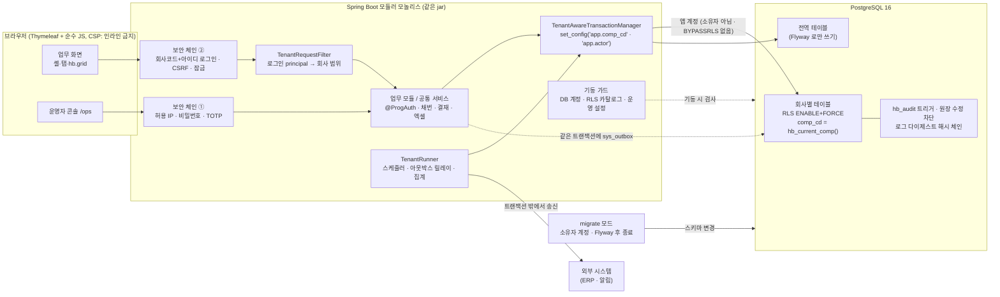
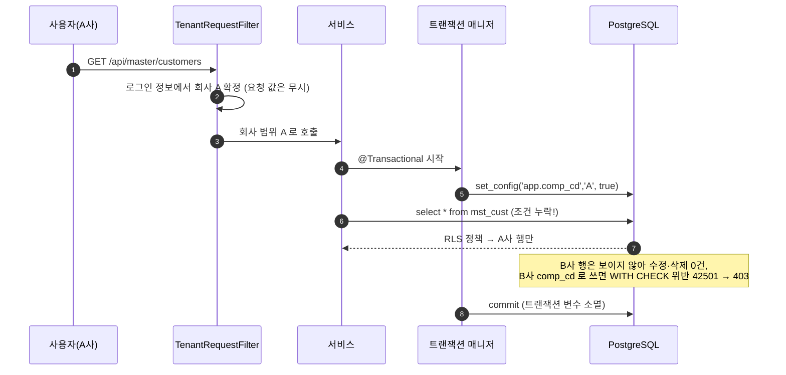

# YeonOS

**스마트팩토리 통합 플랫폼 (MES · QMS · WMS · SRM · APS · 설비관리 · 프로젝트관리 · 설계변경 · APQP) — 직접 만든 공통 플랫폼 계층(회사별 격리·권한·감사·원장 규약) 위에서**

이름은 제 이름의 한자 **連(잇다, Yeon)** 과 공장을 움직이는 **OS** 를 합쳤습니다. 생산·품질·창고·설비·협력사·프로젝트를 품목·LOT·설비·작업지시 같은 *같은 키*로 *잇는* 공장 운영 체계가 이 플랫폼의 설계 중심입니다 — 한 방향 흐름이 아니라 모듈끼리 여러 방향으로 데이터를 주고받습니다.

여러 제조 고객사의 MES 를 구축하면서 매번 다시 만들던 공통분모(기준정보·채번·결재·LOT·라벨·권한)와 매번 다시 겪던 문제(채번 중복, 회사 간 데이터 섞임, 조용히 실패하는 저장, 화면과 엑셀 SQL 불일치)를 **한 번 제대로** 설계·구현한 개인 프로젝트입니다. 실무 경험이 어떤 설계 판단으로 이어지는지 보여 주는 포트폴리오이자 학습 기록입니다.

## 라이브 데모 · 체험 계정

| 항목 | 값 |
|---|---|
| 주소 | (공개 데모 주소 — 배포 도메인이 정해지면 적습니다) |
| 회사코드 | `DEMO` |
| 아이디 | `user1` |
| 비밀번호 | `yeonos-demo-1234` |

- 로그인 화면에도 같은 안내가 나오고, 회사코드·아이디는 미리 채워져 있습니다.
- **볼 수 있는 것**: 기준정보·영업·생산은 등록·수정까지, POP 단말 등록(`/pop` 체험), 그 밖의 모든 업무 모듈(품질·창고·구매·설비·프로젝트·계획·설계변경·APQP)과 홈은 조회. 시스템 관리 화면·비밀번호 변경은 막혀 있습니다.
- 데이터는 **매일 04:00(KST) 초기화**됩니다 — 입력한 내용은 남지 않으니 실제 정보를 넣지 마세요. 화면의 거래처·품목·담당자는 모두 가상 데이터입니다.
- 무료 클라우드 VM 이라 첫 화면이 느리거나, 유휴 회수로 잠시 멈춰 있을 수 있습니다. 설계·운영 방식은 [docs/23](docs/23_공개데모_배포.md).

## 모듈

각 모듈이 무엇을 관리하고 무엇은 다른 모듈 몫인지, 핵심 원장과 모듈 사이 계약은 [docs/46 0장 모듈 정의](docs/46_업무흐름_화면지도.md), 공장 하나가 돌아가는 큰 흐름 9개와 화면 122개의 "왜·언제·주요 동작"은 같은 문서 1~9장에 있습니다(앱에서는 각 화면 [도움말]).

| 모듈 | 한 줄 정의 |
|---|---|
| 기준정보 | 거래처·품목·BOM·라우팅·장비 계층·설비·특성·작업자 — 모든 흐름이 같은 키로 이어지게 하는 바닥 데이터 |
| 영업 | 수주·고객 내시를 받는다 |
| 계획(APS) | 작업지시를 언제·어느 설비에서 할지 유한 능력으로 계산한다 |
| 생산(MES)·POP | 작업지시를 내리고 현장 실적·불량·투입을 받아 LOT 계보로 남긴다 |
| 품질(QMS) | 검사·SPC·계측기·NCR·봉쇄·CAPA·4M 변경 — 기준대로 만들었는지 재고, 어긋나면 막고 고친다 |
| 창고(WMS)·PDA | 재고 원장(입고·이동·실사·출하, 역분개 정정)과 로케이션·라벨 |
| 구매(SRM)·협력사 포털 | 구매요청·발주·납기 회신·ASN·반품·클레임·협력사 평가 |
| 설비관리(CMS) | 고장·보전 작업지시·예방점검·예비품·설비 KPI |
| 프로젝트관리(PMS) | 개발 프로젝트의 WBS·기준선·산출물·게이트·공수 |
| 설계변경(PLM) | ECR → ECO → 적용·고객 통지(PCN)·PPAP |
| APQP | PFMEA·관리계획서·AP 규칙 |
| 홈·시스템 | 역할별 홈 카드 / 사용자·권한·메뉴·정책·결재·알림·감사 |

---

## 핵심 설계

| 주제 | 무엇을 했나 | 왜 |
|---|---|---|
| **멀티테넌트 격리** | 공유 DB + `comp_cd` + PostgreSQL **RLS(FORCE)**, 트랜잭션마다 `set_config('app.comp_cd')` | 앱 코드의 `where comp_cd = ?` 누락 한 번이 다른 회사 데이터 노출로 이어지지 않게 — DB 가 마지막 방어선 |
| **조용한 실패 막기** | 기동 가드: 앱 계정이 슈퍼유저·BYPASSRLS·테이블 소유자·소유자 롤 멤버면 기동 중단, RLS 우회 객체(일반 뷰·SECURITY DEFINER·추가 정책) 카탈로그 검사, 운영에서 jar/DB 스키마 버전 불일치 시 기동 중단 | "정상 기동처럼 보이는데 격리가 꺼져 있는" 상태를 테스트에서 실제로 재현했기 때문 |
| **DB 계정 분리** | 소유자(마이그레이션) / 앱(런타임). 운영 앱은 소유자 자격증명을 갖지 않고 같은 jar 를 **마이그레이션 전용 모드**로 따로 실행 | 앱이 털려도 스키마·로그를 고치지 못하게 |
| **원장 규약** | 재고·실적·LOT 계보 등은 UPDATE/DELETE 차단 트리거 + 역분개 행으로만 정정, `occurred_at`·`recorded_at`·`entry_method` 필수(카탈로그 가드) | 사후 조작 불가, 입력 지연·수기 비율을 별도 수집 없이 측정 |
| **변경 감사** | DB 트리거 `hb_audit` 가 전후 값을 기록(행위자 = 트랜잭션 변수), 접속·보안 로그는 분리 트랜잭션, 로그 일 다이제스트 해시 체인 | 앱을 거치지 않은 변경도 남고, DB 관리자가 과거 로그를 고치면 검증에서 드러난다 |
| **결번 없는 채번** | 업무 트랜잭션 안에서만(MANDATORY) `insert … on conflict do update … returning` | MAX+1 패턴의 중복·결번 사고 |
| **아웃박스 3단 릴레이** | 업무와 같은 트랜잭션에 발행 → 짧은 트랜잭션으로 집기 → **트랜잭션 밖에서 송신** → 조건부 결과 기록, `skip locked`·지수 백오프·오래된 SENDING 회수 | 외부 호출을 DB 트랜잭션 안에서 기다리다 커넥션 풀이 고갈된 실제 장애 경험 |
| **결재 엔진** | 업무 테이블을 모르는 엔진 + 문서 유형 핸들러를 **같은 트랜잭션**에서 호출 | 스프링 AFTER_COMMIT 이벤트로는 "결재는 승인, 업무 상태는 그대로"가 생길 수 있어서 |
| **자체 조회 그리드 `hb.grid`** | 라이브러리 없이 서버 페이징·다중 정렬·고정 열·우클릭 메뉴·화면 설정 저장, 엑셀은 **화면 목록과 같은 SQL** 로 서버 스트리밍(수식 주입 방지) | 상용 그리드 라이선스·CSP 제약 없이, 고객사에서 반복된 "화면/엑셀 숫자 불일치"를 구조로 제거 |
| **보안** | CSP(인라인 스크립트·스타일 금지, 가드 테스트), 세션 절대 수명, 로그인 잠금·IP 시도 제한, 운영자 콘솔은 허용 IP + 비밀번호 + **TOTP** + 고객이 허락한 **지원 세션** 안에서만 고객 데이터 열람 | 랜섬웨어·내부자 위험을 전제로 한 설계(docs/05) |

## 아키텍처



**회사 격리가 어떻게 지켜지는가** — 앱 코드에서 `where comp_cd = ?` 를 빠뜨려도 DB 가 막는다.



## 스택

Java 25 · Spring Boot 4.1 (Spring Framework 7, Security 7) · PostgreSQL 16 · MyBatis · Flyway · Thymeleaf + 순수 JavaScript · Testcontainers · Apache POI

선택 근거는 `docs/13`(Java/Spring vs Node.js 등 비교), UI 라이브러리는 `docs/10`(그리드 자체 제작 결정)에 있습니다.

## 진행 상태

P0 플랫폼 → P1 기준정보 → P2 MES(실적 원장·LOT 계보·POP) 완료, QMS·WMS·SRM·CMS·PMS·APS·PLM·APQP·홈·시스템관리는 모듈별 세션이 병렬로 진행 중(2026-10-27 기준 마이그레이션 V199, 화면 122개). 자동 테스트 약 2,600건 — 정상 흐름 + "설마 이렇게 쓰겠어?" 이상 사용, 회사별 기능은 모두 "A사 계정으로 B사 데이터" 시도 포함.

## 문서 (설계 → 결정 → 구현의 근거)

| 문서 | 내용 |
|---|---|
| `docs/01` | P0 플랫폼 계층 설계 (멀티테넌트·보안·백업·단계별 완료 기록) |
| `docs/02`~`16` | 표준·연구, AI 활용, 보안·랜섬웨어, 그리드, 사용성·현장 채택, 시각 디자인, 기술 스택 조사 — 검토를 마친 문서는 끝의 "검토 결과"에 채택·보류·거부와 이유 |
| `docs/17`~`45`, `50` | 모듈별 설계(기준정보·MES·QMS·WMS·SRM·PMS·CMS·APS·PLM·APQP·포털·홈·시스템관리·현장 단말 APK)와 결정 기록 |
| `docs/51`~`52` | 시장 스마트팩토리 솔루션 비교(차트·대시보드 / UI 밖 영역) — 끝의 검토 절에 사용자 결정 |
| `docs/46` | **모듈 정의 · 업무 흐름 · 화면 지도** — 처음 보는 분은 여기부터 |
| `TESTING.md` | 단계별 이상 사용 테스트와 그 과정에서 발견·수정한 결함 |
| `deploy/README.md` | 설치·업그레이드·백업/복원 런북 |

## 로컬 실행

```bash
cp .env.example .env            # 비밀번호·키를 바꾼다 (.env 는 커밋하지 않음)
docker compose up -d --wait     # PostgreSQL 16 (127.0.0.1:5433)
./gradlew bootRun               # http://localhost:8090 — 회사 DEMO / admin, 운영자 콘솔 /ops
./gradlew check                 # 전체 테스트 (Docker 필요)
```

로컬(local 프로필)로 처음 띄우면 **가상 데모 데이터**가 들어갑니다 — 설정은 "자동차 2·3차 협력사(용접·프레스)"이고 거래처 24곳·담당자는 모두 가상입니다(사업자번호는 발급되지 않는 `000` 대역, 메일은 `example.com`). 끄려면 `happyboot.dev.demo-data=false`.
